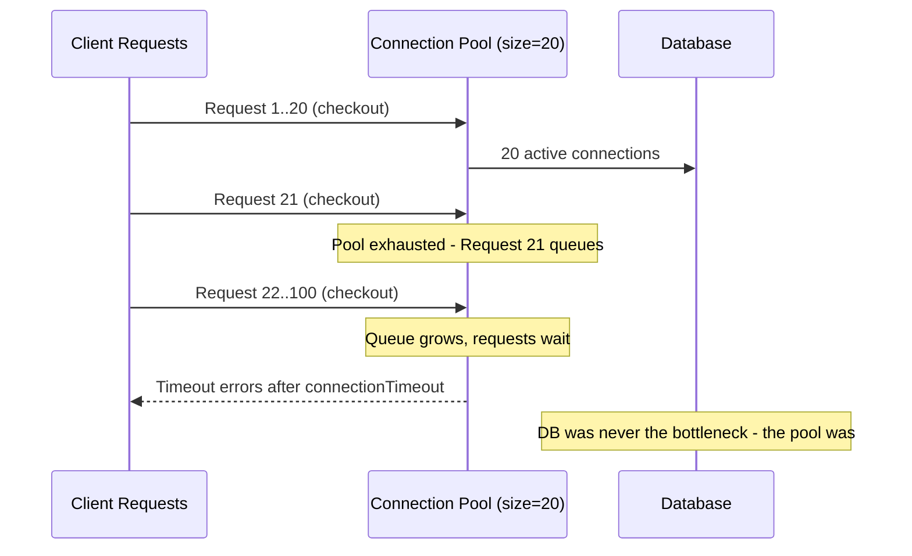
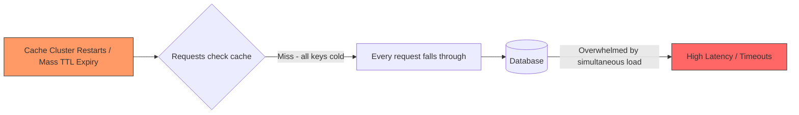
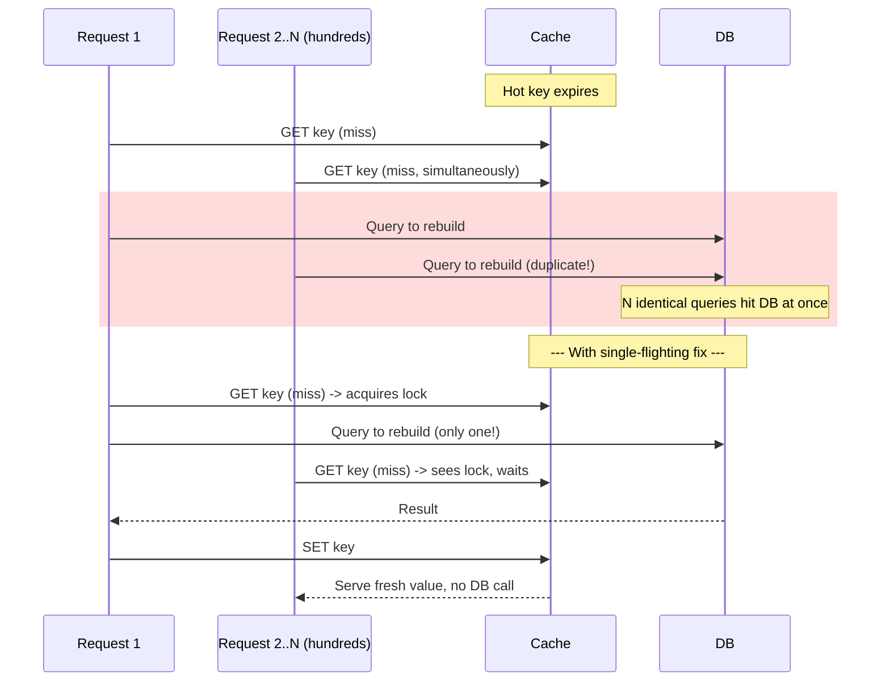
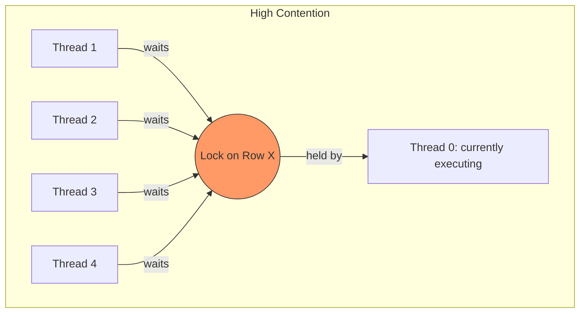
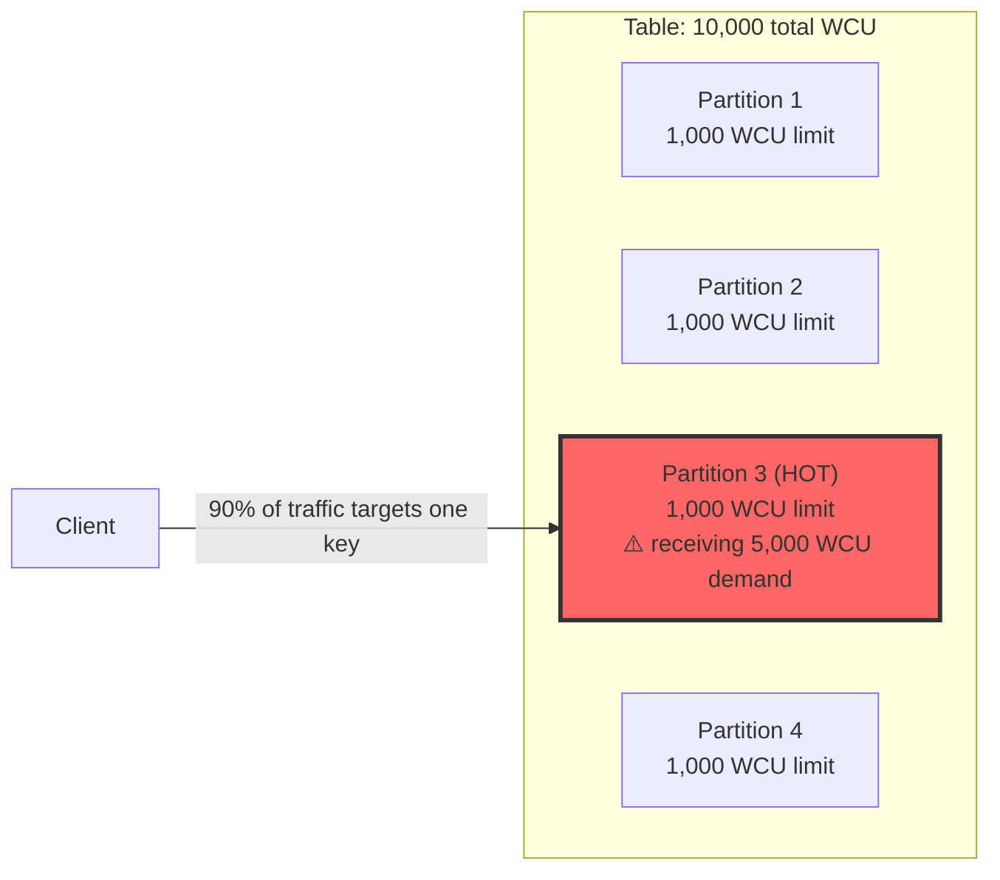
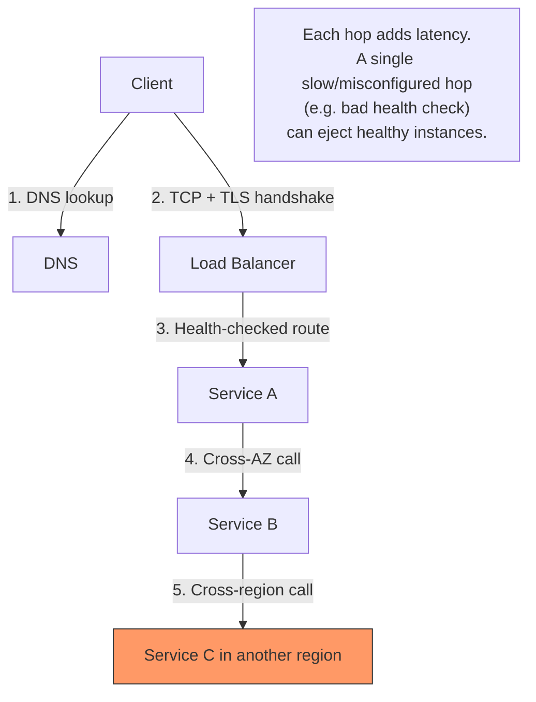
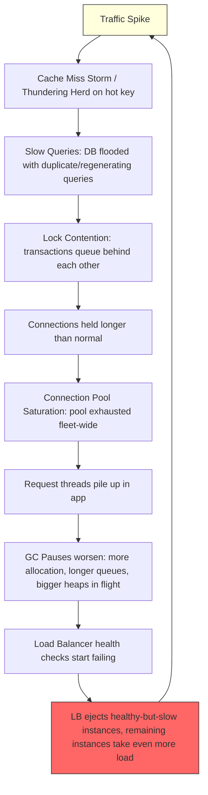

# The Backend "Under Load" Failure Modes: A System Design Interview Deep-Dive

Best reosurce. to learn and prepare for big tech interview: www.prachub.com

**Context:** Interviewers at companies like Atlassian frequently probe backend/system design candidates (3+ YOE) on how a system *degrades* under load, not just how it's architected on a whiteboard when everything is healthy. A common interview pattern looks like this:

> "Your service's p99 latency just went from 50ms to 5000ms during a traffic spike. Walk me through how you'd diagnose it, and what could be causing it."

The eight failure modes below are the usual suspects behind that scenario. This guide covers, for each one: what it is, why it happens, how to detect it, how to fix/prevent it, and a war-story-style scenario you can use to reason out loud in an interview.

---

## Table of Contents

1. [Connection Pool Saturation](#1-connection-pool-saturation)
2. [Cache Miss Storm](#2-cache-miss-storm)
3. [Thundering Herd](#3-thundering-herd)
4. [Lock Contention](#4-lock-contention)
5. [Hot Partitions](#5-hot-partitions)
6. [Slow Queries](#6-slow-queries)
7. [Network Bottlenecks](#7-network-bottlenecks)
8. [GC Pauses](#8-gc-pauses)
9. [The Interview Diagnostic Checklist](#9-the-interview-diagnostic-checklist-cpu--memory--gc--network--lb)
10. [How These Failures Chain Together](#10-how-these-failures-chain-together-the-cascading-failure-picture)
11. [References](#11-references)

---

## 1. Connection Pool Saturation

### What it is
Your application doesn't talk to the database directly on every request — it borrows a connection from a pool (e.g., HikariCP in Java), uses it, and returns it. The pool has a fixed maximum size. When every connection is checked out and requests keep arriving, new requests queue up waiting for a free connection. If they wait long enough, they time out.

### Why it happens
- Pool size too small for the actual concurrency.
- Connections held too long (long transactions, connections leaked and never returned, N+1 queries inside a single transaction).
- A downstream slowdown (slow queries, a stalled dependency) means each connection is held longer than usual, so the *effective* throughput of the pool drops even though the pool size hasn't changed.
- Horizontal scaling multiplies the problem: if you have 50 pods × a pool size of 20, you can offer 1,000 simultaneous connections to a database that may only handle a few hundred well — meaning the pool "protects" a single instance but not the database as a whole.

### Diagnosis
- Pool metrics: active connections ≈ max pool size, and a growing "waiting for connection" queue.
- Symptom: `SQLTransientConnectionException: Connection is not available, request timed out` (Java/HikariCP) or equivalent driver timeout in other stacks.
- Correlate pool exhaustion with a spike in query latency, not just request volume — often the pool isn't undersized, the queries got slow.

### Fix / Prevention
- **Right-size the pool** using the practical formula popularized by HikariCP: `connections ≈ (core_count × 2) + effective_spindle_count` as a *starting point*, then tune with real load tests — bigger isn't always better since excess connections increase context-switching and contention on the DB itself.
- **Fail fast**: set an aggressive `connectionTimeout` (e.g., 2–3s) so requests error out quickly and visibly instead of silently queuing.
- **Cap total connections across the fleet**, not per instance — think in terms of "database connection budget" divided across all replicas, batch jobs, and admin tooling.
- Use a connection multiplexer / proxy (PgBouncer, ProxySQL, Oracle CMAN) to decouple "connections the app thinks it opened" from "connections the DB actually maintains."
- Add leak detection (HikariCP's `leak-detection-threshold`) to catch code paths that check out a connection and never return it.
- Watch out for autoscaling "connection storms": 50 new pods all opening a full pool at boot time can spike DB CPU in seconds. Stagger pool warm-up (e.g., start with `minimum-idle: 1` and grow lazily).

### Scenario to reason through in an interview
> "We have a Spring Boot service behind an HPA. Traffic doubles during a flash sale, Kubernetes scales pods from 20 → 80. Suddenly the database itself falls over — not the app." 
> — This is a **connection storm**: 80 pods × pool size 10 = 800 sudden new connections. The fix isn't "raise the pool size," it's capping total DB connections fleet-wide and warming pools gradually.

---

## 2. Cache Miss Storm

### What it is
A cache is supposed to shield your database from repeated reads of the same data. A "cache miss storm" happens when a large chunk of your cache becomes invalid or unavailable at once — e.g., a cache node restarts, a deploy flushes the cache, or many keys share the same TTL and expire together — and a flood of requests that normally hit the cache now fall through to the database simultaneously.

### Why it happens
- **Synchronized TTLs**: many keys cached at the same time with the same expiry all die together.
- **Cold cache after deploy/restart**: a new cache instance (or a cache cluster failover) starts empty.
- **Cache eviction under memory pressure**: LRU eviction removes hot keys under load, right when you need them most.

### Diagnosis
- Sudden, correlated spike in cache miss rate across many keys (not just one hot key — see Thundering Herd below for the single-key version).
- DB read QPS spikes in lockstep with a cache hit-rate drop.
- Often visible right after a deploy, cache cluster resize, or a node failover event.

### Fix / Prevention
- **Jittered TTLs**: add randomness to expiry (`TTL = base ± random(0, jitter)`) so keys don't all expire at the same moment.
- **Cache warming**: pre-populate the cache before cutting traffic over to a new node/cluster, especially after deploys.
- **Graceful degradation**: serve slightly stale data (stale-while-revalidate) rather than forcing every reader to the DB.
- **Multi-tier caching**: local (in-process) cache + shared cache (Redis/Memcached) so a shared-cache blip doesn't send 100% of traffic to the DB.
- **Read-through with request coalescing** (see Thundering Herd) so even a full cache flush results in one DB query per key, not one per concurrent request.

---

## 3. Thundering Herd

### What it is
A specific, especially vicious form of cache-miss problem: **one single hot key** expires or is invalidated, and every one of its many concurrent readers independently notices the miss and hits the database at the same instant to regenerate it. The name comes from the general OS-level phenomenon: many threads/processes blocked on the same event are all woken up simultaneously, but only one can actually proceed — the rest collide and go back to sleep, wasting resources in the process<cite index="2-1">.</cite>

### Why it happens
- A single, extremely popular cache key (a trending post, a homepage config, a product page during a flash sale) expires.
- Before the first request finishes regenerating it, hundreds/thousands of others also see the miss and each independently query the database for the same data<cite index="7-1">, turning one legitimate cache-refill into a flood of duplicate, redundant queries against the backing store</cite>.
- This is self-reinforcing: the more concurrent load there is, the slower the regenerating query runs, which widens the window during which more requests pile in<cite index="6-1">.</cite>

### A real-world illustration
A widely cited (if informally documented) example: a product recommendation cache expiring at scale caused tens of thousands of concurrent requests to hit the primary database within seconds, spiking DB CPU to near-saturation and taking checkout pages down for several minutes — a useful mental model for how fast this can cascade<cite index="7-1">even though the underlying failure is "just" a single expired cache key</cite>.

### Diagnosis
- One specific key/query pattern dominates the miss spike (as opposed to Cache Miss Storm's broad, multi-key pattern).
- DB slow query log shows the *exact same query* running dozens/hundreds of times concurrently.
- Correlates precisely with the TTL of one hot object.

### Fix / Prevention
- **Request coalescing / single-flighting**: on a miss, the first request acquires a lock and regenerates the cache; every other concurrent request for the same key waits briefly and then reads the now-fresh cache entry instead of also querying the DB<cite index="8-1">— the real design question becomes "how do I elect a single leader to rebuild this key while everyone else waits," not "what happens on a miss."</cite>
- **Probabilistic early expiration**: refresh the key *before* it actually expires, with increasing probability as the expiry approaches, so regeneration happens off the critical path and there's no hard cliff<cite index="7-1">.</cite>
- **Never let TTL be the only expiry mechanism for hot keys** — actively refresh them in the background (cron/worker) so they never truly "miss."
- **Locking with a short grace period**: hold a mutex per key during regeneration; other readers serve stale data for a few hundred ms rather than blocking on the DB.

---

## 4. Lock Contention

### What it is
Multiple threads/processes need exclusive access to the same resource (a row, a data structure, a critical section of code) and end up serializing behind a lock. As concurrency increases, more time is spent waiting for locks than doing useful work.

### Why it happens
- Coarse-grained locks (locking an entire table/object when only a small part needs protection).
- Long-held locks (a transaction holding a row lock while doing slow, unrelated work like an external API call).
- High contention on a small number of "hot" rows — e.g., everyone incrementing the same counter row, or many transactions updating the same inventory record.
- In application code: synchronized blocks or mutexes guarding shared in-memory state.

### Diagnosis
- Thread dumps show many threads `BLOCKED` waiting on the same monitor/lock.
- Database: `SHOW ENGINE INNODB STATUS` (MySQL) or `pg_locks` (Postgres) reveals long lock wait chains and deadlock victims.
- CPU utilization can look *low* even though latency is high — a classic tell that the bottleneck is waiting, not computing.
- Throughput plateaus or drops even as you add more threads/instances (Amdahl's Law in action — the serialized portion dominates).

### Fix / Prevention
- **Reduce lock scope and hold time**: do slow work (I/O, external calls) *outside* the critical section.
- **Move from pessimistic to optimistic concurrency control** where contention is high but conflicts are rare (versioned rows / compare-and-swap instead of `SELECT ... FOR UPDATE`).
- **Shard the contended resource**: instead of one counter row, use N counter shards and sum them (classic hot-row mitigation, same principle as hot partitions below).
- **Use appropriate isolation levels**: don't default to the strictest isolation level everywhere; understand what your actual consistency requirement is.
- **Queue-based serialization**: if a resource genuinely must be updated one-at-a-time, make that explicit via a queue rather than many threads fighting over a lock.

---

## 5. Hot Partitions

### What it is
In a sharded / partitioned data store (DynamoDB, Cassandra, sharded MySQL/Postgres), data is distributed across nodes by hashing a partition key. A "hot partition" occurs when a disproportionate share of traffic lands on one partition — because one key (or a small set of keys) is far more popular than the rest — even though the *cluster as a whole* has plenty of spare capacity<cite index="16-1">.</cite>

### Why it happens
- **Low-cardinality keys**: partitioning by something like `status = "ACTIVE"` or a date-only value concentrates huge volumes of data/traffic on very few partition values<cite index="15-1">.</cite>
- **Celebrity/viral effect**: one user, one product, one leaderboard entry suddenly gets orders of magnitude more reads/writes than everyone else.
- **Time-series data**: writing with a key like `deviceId` or a fixed date bucket means all of "today's" writes land on the same physical partition, since time-ordered data inherently targets a single logical key repeatedly<cite index="17-1">.</cite>
- Crucially: per-partition throughput limits are hard limits — in DynamoDB, for example, a single partition tops out at roughly 3,000 RCU/1,000 WCU **regardless of how much total capacity the table has provisioned**, so a hot partition throttles even when the table "looks" underutilized<cite index="18-1">.</cite>

### Diagnosis
- Throttling errors (e.g., `ProvisionedThroughputExceededException`) even though aggregate table/cluster metrics show capacity to spare<cite index="18-1">.</cite>
- Use per-key traffic visibility tooling (e.g., CloudWatch Contributor Insights for DynamoDB) to identify which specific keys are "hot" before trying to fix anything blindly<cite index="15-1">.</cite>

### Fix / Prevention
- **Write sharding**: append a random or hashed suffix to the hot partition key (`user#123` → `user#123#shard3`) so writes spread across N physical partitions, then fan-in reads across all shards and aggregate<cite index="19-1">.</cite>
- **Composite keys with higher cardinality**: combine a low-cardinality attribute with a high-cardinality one (e.g., `"ACTIVE#customer123"` instead of just `"ACTIVE"`) to break up artificial hot spots<cite index="15-1">.</cite>
- **Shard selectively**: you don't need to shard your whole keyspace — only shard the specific hot entities (e.g., only the top 100 most-active leaderboard users), leaving the long tail on simple, single-key design<cite index="20-1">.</cite>
- **Cache in front of the hot partition**: offload read pressure with DAX/Redis so the partition itself only sees a fraction of true read volume<cite index="22-1">.</cite>
- **Time-bucketing for time-series**: instead of one key growing forever, roll into new partition keys per time window (per hour/day) to spread sustained write load.
- Note that built-in mechanisms like DynamoDB's Adaptive Capacity can help automatically, but they take several minutes to kick in — not fast enough to save you from a sudden spike, so proactive key design still matters<cite index="20-1">.</cite>

---

## 6. Slow Queries

### What it is
The most direct root cause on this list — a query that takes far longer than it should, tying up connections, locks, and CPU/IO on the database, and cascading into every other failure mode above (pool saturation, lock contention, timeouts).

### Why it happens
- Missing or unused indexes, causing full table scans.
- N+1 query patterns from ORMs (one query to fetch a list, then one query per item to fetch related data).
- Poor query plans due to stale statistics.
- Large, unbounded result sets (`SELECT *` with no pagination/limit).
- Lock waits disguised as "slow queries" — the query itself is fast, but it's queued behind another transaction's lock.
- Open-session-in-view patterns (common in Spring) that keep a DB transaction open for the entire HTTP request lifecycle, including slow downstream calls, making otherwise-fast queries "hold" connections far longer than necessary.

### Diagnosis
- Slow query logs (`slow_query_log` in MySQL, `log_min_duration_statement` in Postgres).
- `EXPLAIN ANALYZE` to check for sequential scans where an index scan was expected.
- APM traces showing time spent in DB calls vs. application logic.
- Correlate a rise in average query duration with the *rest* of the cascade: it's very often the actual root cause behind "the connection pool is exhausted" or "lock wait timeouts spiked."

### Fix / Prevention
- Add/verify indexes matching actual query predicates and sort orders.
- Fix N+1 patterns with eager loading / batched fetches.
- Set query timeouts so one bad query can't monopolize a connection indefinitely.
- Paginate everything; never return unbounded result sets.
- Disable open-session-in-view where it's not needed, and keep transactions as short as possible.
- Use read replicas to offload read-heavy queries away from the primary.

---

## 7. Network Bottlenecks

### What it is
Latency or throughput limits introduced by the network path between services — not the services themselves. Includes bandwidth saturation, DNS resolution delays, TLS handshake overhead, cross-region/cross-AZ hops, and load balancer or proxy limits.

### Why it happens
- Chatty microservices making many small synchronous calls instead of batching.
- Cross-region calls adding tens to hundreds of ms of unavoidable latency per hop.
- Load balancer health checks or connection limits misconfigured, causing healthy instances to be marked unhealthy or connections to be dropped.
- NIC/bandwidth saturation on a single host under heavy fan-out (e.g., broadcasting to many downstream services at once).
- DNS caching issues causing repeated, slow lookups under load.

### Diagnosis
- Compare "time in app code" vs. "time in transit" using distributed tracing (e.g., a trace waterfall showing large gaps between spans).
- Check load balancer metrics: active connections, backend error rate, health check failures.
- `ping`/`traceroute`/`mtr` for raw latency and packet loss between hosts (in a debuggable environment).
- Rule out DNS: slow or failing resolution often masquerades as a generic "connection timeout."

### Fix / Prevention
- Reduce cross-service chattiness: batch requests, use gRPC/streaming where appropriate instead of many round trips.
- Co-locate latency-sensitive services in the same AZ/region.
- Tune load balancer health check intervals/thresholds so transient blips don't cause mass instance ejection.
- Use connection keep-alive and HTTP/2 multiplexing to avoid repeated handshake overhead.
- Circuit breakers and timeouts on all outbound calls so one slow network path doesn't stall the whole request chain.

---

## 8. GC Pauses

### What it is
In managed-memory runtimes (JVM, .NET CLR, Go's GC, etc.), the garbage collector periodically pauses application threads ("stop-the-world" pauses) to reclaim memory. Under memory pressure or with a poorly tuned collector, these pauses grow long and frequent enough to show up as latency spikes and, in extreme cases, cause the process to be marked unhealthy by orchestration/load balancers.

### Why it happens
- Heap sized too small for the actual working set, forcing frequent collections.
- High allocation rate (lots of short-lived object churn) overwhelming the young generation.
- Memory leaks (objects that should be garbage but are still referenced) growing the old generation until a full GC is needed.
- Using an old/default GC algorithm (e.g., Parallel GC) instead of a low-pause collector (G1, ZGC, Shenandoah) for latency-sensitive services.
- Large heaps paradoxically making *full* GC pauses worse if not tuned for concurrent/incremental collection.

### Diagnosis
- GC logs (`-Xlog:gc*` in modern JVMs) showing pause duration and frequency.
- Correlate p99/p999 latency spikes with GC pause timestamps — a very common "smoking gun" in a postmortem.
- Heap dumps / profilers (e.g., async-profiler, VisualVM) to find allocation hotspots or leaks.
- Kubernetes liveness probe failures that line up exactly with long GC pauses (the process is "alive" but unresponsive during STW).

### Fix / Prevention
- Choose a low-pause collector for latency-sensitive services (G1 as a solid default; ZGC/Shenandoah for very large heaps needing sub-millisecond pauses).
- Right-size the heap: too small causes GC thrashing, too large (without a concurrent collector) causes long full-GC pauses.
- Reduce allocation pressure: object pooling for very hot paths, avoiding unnecessary boxing/autoboxing, streaming instead of buffering large payloads.
- Fix memory leaks (common culprits: unbounded caches, listeners/callbacks never unregistered, ThreadLocals not cleared).
- Set liveness probe thresholds with GC pause behavior in mind, so a normal (if long) GC pause doesn't trigger an unnecessary pod restart, compounding the problem.

```mermaid
gantt
    title Request Latency vs GC Pause Timeline
    dateFormat X
    axisFormat %L ms

    section Normal Requests
    Request A (fast) :done, 0, 20
    Request B (fast) :done, 20, 40

    section GC Event
    Stop-the-world GC pause :crit, 40, 90

    section Blocked Requests
    Request C (blocked, then spikes) :active, 40, 95
    Request D (blocked, then spikes) :active, 45, 98
```

---

## 9. The Interview Diagnostic Checklist (CPU / Memory / GC / Network / LB)

When an interviewer says "the service is slow, how do you debug it," this is the mental checklist worth narrating out loud, roughly in this order:

1. **CPU check karo** — Is CPU actually maxed out, or is it low despite high latency? Low CPU + high latency usually points to *waiting* (locks, I/O, network), not *computing*.
2. **Memory check karo** — Is the process near its memory limit? Is memory climbing over time (leak) or spiking in bursts (allocation storm)?
3. **Garbage Collection pauses dekho** — Correlate GC pause timestamps with latency spikes. This is often the fastest way to confirm/rule out GC as the culprit.
4. **Network latency verify karo** — Use distributed tracing to see how much time is "in the network" vs. "in application code." Check for cross-AZ/region hops.
5. **Load Balancer healthy hai ya nahi** — Check LB-level metrics: are backend instances flapping between healthy/unhealthy? Are health check failures correlated with GC pauses or connection pool exhaustion (i.e., is the LB *reacting to* a downstream problem rather than causing one)?

The underlying interview skill being tested isn't memorizing this list — it's demonstrating that you reason from **symptom → correlated metrics → root cause → fix**, and that you understand how these eight failure modes often chain into and mask each other (see below).

---

## 10. How These Failures Chain Together (The Cascading Failure Picture)

In real incidents, these rarely happen in isolation. A typical cascade:

This is why a strong interview answer names the failure mode you'd check *first*, but also explains how you'd distinguish root cause from downstream symptom — e.g., "pool exhaustion is often not a pool sizing problem, it's a symptom of slow queries or lock contention upstream."

---

## 11. References

**Connection Pool Saturation**
- [HikariCP Connection Pool Tuning — JOptimize](https://joptimize.io/blog/hikaricp-connection-pool-tuning-spring-boot)
- [Database Connection Pool Tuning: HikariCP, PostgreSQL, and Traffic Spikes — CodeSprintPro](https://codesprintpro.com/blog/database-connection-pool-tuning/)
- [Preventing Exhaustion with HikariCP Connection Tuning — System Design Vault](https://www.pranabesh.com/vault/hikari-connection-pool-tuning/)
- [Hikari Connection Pool: A Production-Ready Guide](https://goreplay.org/blog/hikari-connection-pool/)

**Cache Miss Storm / Thundering Herd**
- [Thundering Herd Problem — Wikipedia](https://en.wikipedia.org/wiki/Thundering_herd_problem)
- [Cache Stampede — Wikipedia](https://en.wikipedia.org/wiki/Cache_stampede)
- [Cache Stampede: Understanding and Solving the Thundering Herd Problem — SWE Helper](https://swehelper.com/blog/cache-stampede/)
- [How to Handle Cache Stampede (Thundering Herd) in Redis](https://oneuptime.com/blog/post/2026-01-21-redis-cache-stampede/view)
- [Thundering Herd Problem: Solutions & Prevention](https://howtech.substack.com/p/thundering-herd-problem-cache-stampede)

**Lock Contention**
- MySQL: `SHOW ENGINE INNODB STATUS` documentation (InnoDB lock monitoring) — [dev.mysql.com](https://dev.mysql.com/doc/refman/8.0/en/innodb-lock-monitor.html)
- PostgreSQL: `pg_locks` system view — [postgresql.org/docs](https://www.postgresql.org/docs/current/view-pg-locks.html)

**Hot Partitions**
- [AWS: Key range throughput exceeded (hot partitions) — DynamoDB Developer Guide](https://docs.aws.amazon.com/amazondynamodb/latest/developerguide/throttling-key-range-limit-exceeded-mitigation.html)
- [What is a DynamoDB Hot Partition? — ScyllaDB Glossary](https://www.scylladb.com/glossary/dynamodb-hot-partition/)
- [How to Handle DynamoDB Hot Partitions — OneUptime](https://oneuptime.com/blog/post/2026-02-12-dynamodb-hot-partitions/view)
- [Managing Partitions, Sharding, and Split-for-Heat in DynamoDB](https://newsletter.simpleaws.dev/p/partitions-sharding-split-for-heat-dynamodb)
- [7 DynamoDB Partition Fixes That Calm Hot Keys — Medium](https://medium.com/@bhagyarana80/7-dynamodb-partition-fixes-that-calm-hot-keys-6f528cf9cd48)

**Slow Queries**
- PostgreSQL `EXPLAIN` documentation — [postgresql.org/docs](https://www.postgresql.org/docs/current/using-explain.html)
- MySQL Slow Query Log — [dev.mysql.com/doc](https://dev.mysql.com/doc/refman/8.0/en/slow-query-log.html)

**Network Bottlenecks**
- [AWS Well-Architected Framework — Performance Efficiency Pillar](https://docs.aws.amazon.com/wellarchitected/latest/performance-efficiency-pillar/welcome.html)

**GC Pauses**
- [Oracle: Garbage Collection Tuning Guide (JVM)](https://docs.oracle.com/en/java/javase/21/gctuning/)
- [Getting Started with the G1 Garbage Collector — Oracle](https://www.oracle.com/technical-resources/articles/java/g1gc.html)
- [ZGC — OpenJDK Wiki](https://wiki.openjdk.org/display/zgc)

---

### A note on sourcing

This guide pulls from official documentation (AWS, Oracle/OpenJDK, PostgreSQL, MySQL) and independent engineering blogs/newsletters. For system design interview *practice specifically*, cross-reference against multiple prep resources and real interview experience threads (e.g., Glassdoor, Blind, LeetCode Discuss, and dedicated interview-prep sites) rather than relying on any single source — question patterns and interviewer expectations vary company to company and change over time.
